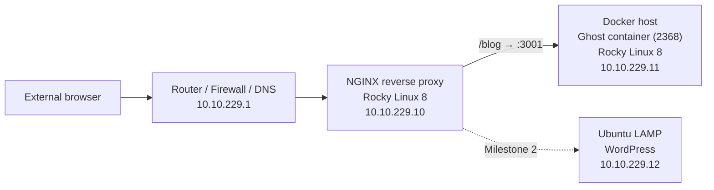

# Marconi Law Firm — Proof of Concept Web Infrastructure

A multi-VM web hosting lab built for my Cyber Crime and Incident Response coursework at Full Sail University. The scenario: a client (the fictional Marconi Law Firm in Orlando, FL) needs a website, and this repo is the proof of concept and audit documentation for how it's built and secured.

The stack runs a **Ghost blog in a Docker container**, published to users through an **NGINX reverse proxy**, with a **WordPress LAMP stack** on Ubuntu as the next phase and a **WordPress hardening** phase to close it out.

| Milestone | Scope | Status |
|---|---|---|
| 1 | SSH access, Docker + Ghost, NGINX reverse proxy, log review | ✅ Complete |
| 2 | Ubuntu LAMP stack, MySQL, WordPress install | 🚧 In progress |
| 3 | WordPress hardening (file permissions, wp-config.php, Shield WAF) | 📋 Planned |

## Network topology



Traffic from a browser hits the NGINX VM on port 80. Requests for `/blog` are forwarded to the Docker host on port 3001, which Docker maps to Ghost's internal port 2368. The backend servers are never exposed directly to the user.

## Environment

All VMs run on Proxmox VE in an isolated lab network.

| Host | OS | Role | IP |
|---|---|---|---|
| Firewall VM | — | Router, firewall, DNS, default gateway | 10.10.229.1 |
| NginxZacharias | Rocky Linux 8 | NGINX reverse proxy | 10.10.229.10 |
| DockerZacharias | Rocky Linux 8 | Docker CE host running Ghost | 10.10.229.11 |
| Ubuntu | Ubuntu 20.04 | Admin workstation (SSH client) and LAMP/WordPress server | 10.10.229.12 |

**Network:** `ITE229` · `10.10.229.0/24` · gateway and DNS `10.10.229.1`

## What I built

- Installed OpenSSH on the Ubuntu workstation and managed both Rocky Linux servers remotely over SSH
- Set hostnames with `nmtui`, updated packages, and added the EPEL repository
- Added the official Docker CE repository and installed Docker Engine, the CLI, containerd, and the Buildx/Compose plugins
- Deployed Ghost (Node.js) as a container with a host port mapping and a `url` environment variable pointing at the proxy path
- Installed NGINX and configured a `location /blog` reverse proxy block with forwarded client headers
- Verified the setup from a browser and reviewed NGINX access and error logs with `tail`

## Skills demonstrated

Linux administration (RHEL-family and Debian-family) · SSH remote management · package and repository management · Docker container deployment · NGINX reverse proxy configuration · systemd service management · SELinux and firewalld · log analysis · technical documentation for audit purposes

## Documentation

| Doc | Covers |
|---|---|
| [01 – SSH access](docs/01-ssh-access.md) | OpenSSH client setup and remote login |
| [02 – Ghost on Docker](docs/02-ghost-on-docker.md) | Docker CE install and Ghost container deployment |
| [03 – NGINX reverse proxy](docs/03-nginx-reverse-proxy.md) | NGINX install and `/blog` proxy config |
| [04 – Verification and logs](docs/04-verification-and-logs.md) | Browser test, log review, troubleshooting |
| [Security considerations](docs/security-considerations.md) | Lab shortcuts and how I'd handle them in production |

Config files are in [`configs/`](configs/), and [`scripts/`](scripts/) has the setup steps rewritten as repeatable shell scripts.

## Security note

To match the course lab, SELinux and firewalld were disabled on the Rocky Linux VMs. That's fine for an isolated classroom network but not something I'd do in production. [Security considerations](docs/security-considerations.md) explains the risk and the proper alternative, and the scripts in this repo use the hardened approach instead.

No credentials are stored in this repository.

## Repository layout

```
.
├── README.md
├── configs/
│   └── nginx/default.d/ghost-blog.conf
├── docs/
│   ├── 01-ssh-access.md
│   ├── 02-ghost-on-docker.md
│   ├── 03-nginx-reverse-proxy.md
│   ├── 04-verification-and-logs.md
│   └── security-considerations.md
├── scripts/
│   ├── docker-host-setup.sh
│   └── nginx-proxy-setup.sh
└── screenshots/
```

## Author

**Zaine Zacharias-Whitfield** — Cybersecurity student, Full Sail University
